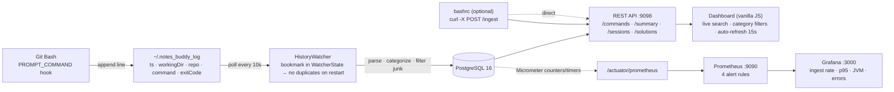
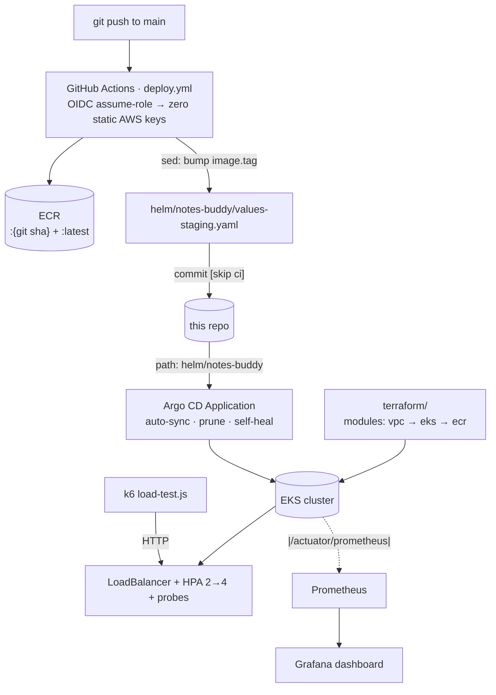

# ⚡ Notes Buddy

> A personal engineering journal that writes itself.

Every command you type in Git Bash is captured with its working directory, git repo,
exit code and timestamp — then turned into a searchable, categorized engineering log
with daily summaries, sessions, full-text search and solution cards for repeated errors.

Built as a full platform, not a script: **Spring Boot · PostgreSQL · Docker · Helm ·
Argo CD GitOps · EKS (Terraform) · GitHub Actions OIDC → ECR · Prometheus/Grafana · k6.**

---

## Architecture — how one command becomes a dashboard row



The watcher is the only component that reads the log file; it stores its byte position in
the database, so restarts are idempotent. Everything else is a plain REST read path, which
is why the UI, `curl`, k6 and the alerting stack can all hit the same endpoints.

---

## Platform — CI/CD, GitOps and infrastructure



| Layer | What's in the repo |
|---|---|
| IaC | `terraform/` — `vpc`, `eks`, `ecr` modules + root wiring, remote state + lock |
| CI/CD | `.github/workflows/deploy.yml` — build → ECR push → chart tag bump → commit |
| GitOps | `argocd/apps/notes-buddy.yaml` — Application with `autoSync`, `prune`, `selfHeal` |
| Packaging | `helm/notes-buddy` — one chart, three environments (`values-dev/staging/production`) |
| Raw manifests | `k8s/` — Deployment, Service, HPA, Postgres, RBAC for the deployer, ConfigMap, Secret |
| Observability | `prometheus.yml`, `prometheus-alerts.yml`, `grafana-dashboard.json` |
| Load test | `load-test.js` — k6 scenarios: `ingest`, `search`, `mixed`, `pollers` |

---

## Quick start

### Option A — whole stack with Docker Compose (recommended)

```bash
git clone https://github.com/Mojojojo0222/notes_buddy.git
cd notes_buddy

docker compose up --build -d
```

| Service | URL | Credentials |
|---|---|---|
| App + dashboard | http://localhost:9098 | — |
| PostgreSQL | localhost:5432 | `notesbuddy` / `notesbuddy` |
| Prometheus | http://localhost:9090 | — |
| Grafana | http://localhost:3000 | `admin` / `admin` |

Postgres is `depends_on: service_healthy` (its `pg_isready` healthcheck gates app start),
and the H2→Postgres migration is already done — the DB is the platform DB, not an
in-memory toy.

Optional demo data:

```bash
bash docs/seed-data.sh                    # seeds against http://localhost:9098
URL=http://<host>:9098 bash docs/seed-data.sh
```

### Option B — just the app

```bash
# needs a reachable PostgreSQL (defaults in src/main/resources/application.properties)
mvn spring-boot:run                       # → http://localhost:9098
```

Every datasource key is env-overridable (`PORT`, `DB_HOST`, `DB_NAME`, `DB_USER`, `DB_PASS`),
which is the same contract the Helm chart and ConfigMaps use — no config forks per environment.

### Option C — capture your own terminal

Add to `~/.bashrc`:

```bash
NOTES_LOG="$HOME/.notes_buddy_log"

log_command() {
    local last_cmd exit_code=$?
    last_cmd=$(history 1 | sed 's/^[ ]*[0-9]*[ ]*//')
    local repo
    repo=$(git rev-parse --show-toplevel 2>/dev/null | xargs basename 2>/dev/null || echo "none")
    echo "$(date '+%Y-%m-%dT%H:%M:%S')|$(pwd)|${repo}|${last_cmd}|${exit_code}" >> "$NOTES_LOG"
}
export PROMPT_COMMAND='history -a; log_command'
```

`HistoryWatcher` picks the file up within 10 seconds. Prefer no file? Post straight to
`/ingest` instead — both paths land in the same table (see `docs/COMMANDS.md` for the
curl variant).

---

## Features

| Feature | Implementation |
|---|---|
| Command capture | `.bashrc` hook → `~/.notes_buddy_log` → `HistoryWatcher` (10s poll) |
| Idempotent restart | `WatcherState` bookmark — no duplicate rows after a restart |
| Repo + directory tracking | `git rev-parse --show-toplevel` at prompt time |
| Exit codes | failed commands keep their code; weekly summary counts them |
| Auto categories | git, docker, kubernetes, terraform, build, files, network, editor, other |
| Search | `ILIKE` across command, directory, repo, tag and category |
| Sessions | commands grouped by >30 min idle gaps |
| Solution cards | a command that fails repeatedly surfaces the fix you tagged next to it |
| Tags | `POST /commands/{id}/tag` labels a command (this is what feeds solution cards) |
| Dashboard | single-file vanilla JS UI — live search, multi-select filters, 15s refresh, `escapeHtml()` on every row |

---

## API

Base URL `http://localhost:9098`

| Method | Path | Purpose |
|---|---|---|
| GET | `/` | dashboard |
| GET | `/commands/all` | every command, newest first |
| GET | `/commands/by-date?date=YYYY-MM-DD` | one day |
| GET | `/commands/search?q=docker` | full-text search |
| POST | `/commands/{id}/tag?tag=myLabel` | tag a command |
| GET | `/summary` | today: count, most used, topics |
| GET | `/summary/weekly` | last 7 days incl. error count |
| GET | `/sessions` | work sessions split on 30-min gaps |
| GET | `/solutions` | repeated errors + their suggested fixes |
| POST | `/ingest` | ingestion (`text`, `workingDir`, `repoName`, `timestamp`, `exitCode`) |
| GET | `/actuator/health` | probes for k8s liveness/readiness |
| GET | `/actuator/prometheus` | metrics scraped by Prometheus |

```json
// GET /commands/all
[{ "id": 1, "text": "git status", "category": "git",
   "workingDir": "/e/Notes_Buddy", "repoName": "notes-buddy",
   "exitCode": 0, "savedAt": "2026-06-28T22:03:15" }]
```

---

## Deployment

```bash
# DEV — ClusterIP, 1 replica, no HPA
helm install notes-buddy ./helm/notes-buddy -f helm/notes-buddy/values-dev.yaml -n notes-buddy --create-namespace

# STAGING — LoadBalancer, 2 replicas, HPA 2→4 (what Argo CD deploys)
helm install notes-buddy ./helm/notes-buddy -f helm/notes-buddy/values-staging.yaml -n notes-buddy --create-namespace

helm template notes-buddy ./helm/notes-buddy -f helm/notes-buddy/values-dev.yaml   # render offline
helm lint ./helm/notes-buddy
```

GitOps path (what runs in the cluster):

```bash
kubectl apply -f argocd/apps/notes-buddy.yaml   # Argo CD watches helm/notes-buddy on main
```

Push to `main` touching `src/`, `pom.xml`, `Dockerfile`, `helm/**` or the workflow →
Actions builds, pushes `{sha}` + `latest` to ECR, bumps `values-staging.yaml`, commits
back with `[skip ci]` → Argo CD reconciles → new pods. No human kubectl in the loop.

Infra from scratch: `cd terraform && terraform init && terraform plan` — modules are
`vpc` (192.168.0.0/16, one public subnet per AZ with the EKS ELB tags, IGW + routes),
`eks` (cluster, node group, EBS CSI addon, IAM roles) and `ecr` (repository with
`force_delete` so `terraform destroy` is clean).

---

## Observability

**Metrics:** Micrometer → `/actuator/prometheus` → Prometheus scrape.

**Alerts** (`prometheus-alerts.yml`):

| Alert | Fires when |
|---|---|
| `AppDown` | target down for 30s |
| `HighErrorRate` | error rate > 20% over 5m |
| `IngestionStopped` | zero ingests for 10m (log file or watcher died) |
| `SearchLatencyHigh` | search p95 > 2s |

**Dashboards:** `grafana-dashboard.json` — ingestion rate, commands by category, search
p95, totals, failures, JVM heap/non-heap.

**Load test** (k6, run against a live cluster):

```bash
k6 run --env BASE=http://<host> --env SCENARIO=mixed load-test.js
```

Measured on 2× t3.small: **920 RPS sustained ingest with zero errors** (200 VUs);
ceiling at 500 VUs = 718 RPS, 0.28% errors, p95 1.6s — caused by CPU-limit throttling
and probe-timeout cascade, both identified and documented.

---

## Repository layout

```
notes_buddy/
├── src/main/java/com/notesbuddy/
│   ├── NotesApplication.java            # entry point, @EnableScheduling
│   ├── controller/CommandController.java
│   ├── model/                           # Command · Session · WatcherState
│   ├── repository/                      # Spring Data JPA
│   └── service/                         # HistoryWatcher · SummaryService · SessionService
│                                        # SolutionService · CommandService · MetricsService
├── src/main/resources/
│   ├── application.properties           # every key env-overridable
│   └── static/index.html                # dashboard UI
├── helm/notes-buddy/                    # chart + dev/staging/prod values
├── helm/argocd/values.yaml              # Argo CD install values
├── argocd/apps/notes-buddy.yaml         # Application (auto-sync, prune, self-heal)
├── k8s/                                 # raw manifests (Deployment, HPA, Postgres, RBAC)
├── terraform/                           # modules: vpc · eks · ecr + root
├── .github/workflows/deploy.yml         # OIDC → ECR → chart bump → commit
├── prometheus.yml · prometheus-alerts.yml · grafana-dashboard.json
├── load-test.js                         # k6 scenarios
├── docker-compose.yml                   # app + postgres + prometheus + grafana
├── docs/                                # RUNBOOK, CONCEPTS, command reference, day notes
└── Dockerfile                           # multi-stage: maven build → JRE
```

---

## Documentation

| Doc | What's in it |
|---|---|
| [docs/RUNBOOK.md](docs/RUNBOOK.md) | run it everywhere + troubleshooting index |
| [docs/CONCEPTS_MASTER.md](docs/CONCEPTS_MASTER.md) | concept notes with this system as the worked example |
| [docs/COMMANDS.md](docs/COMMANDS.md) | every operational command: build, ECR, terraform, kubectl, helm, Argo CD, API, `.bashrc` |
| [docs/README.md](docs/README.md) | day-by-day build index + file-criticality ranking |
| [ROADMAP.md](ROADMAP.md) | what's built vs. what's next |

---

## Tech stack

| Layer | Technology |
|---|---|
| Backend | Spring Boot 3.2 (Java 17), Spring Data JPA, Actuator + Micrometer |
| Database | PostgreSQL 16 (local H2 support removed — one DB everywhere) |
| Frontend | Vanilla HTML/JS (no build step) |
| Containers | Docker multi-stage build, Docker Compose stack |
| Orchestration | Kubernetes via Helm (dev/staging/prod) + Argo CD |
| CI/CD | GitHub Actions, AWS OIDC federation, Amazon ECR |
| Infrastructure | Terraform (VPC, EKS, ECR modules) |
| Observability | Prometheus, Grafana, 4 alert rules, k6 load tests |

## License

MIT License — use it, fork it, build on it.
